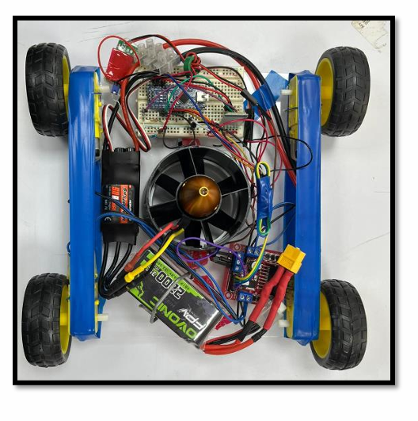
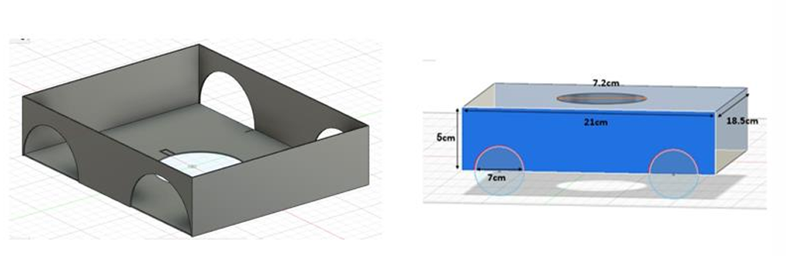
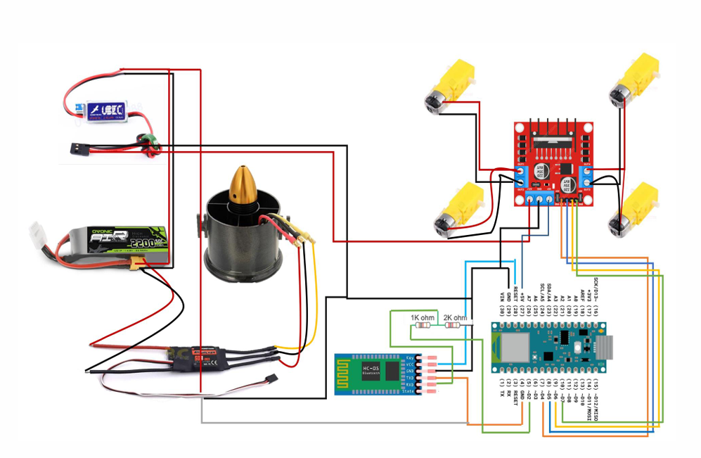

# Wall Climbing Robot 🤖

Senior Design Project (EENG 490), B.Sc. in Electronic Engineering, University of Bahrain (2022–2023).

A wireless robot that clings to vertical surfaces using propeller thrust and drives on four rubber wheels. It was designed for cleaning and inspecting walls and glass where human work is difficult or dangerous.

> Team project with Batool, Behnaz and Zahraa. Supervisor: Dr. Salwa Baserrah. Co-supervisor: Mr. Mohamed Sadeq.



## How it works

- **Adhesion:** a 70 mm electric ducted fan (EDF, 3000KV brushless motor) pushes the robot against the wall. Friction between the wheels and the wall holds it up.
- **Movement:** four BO gear motors with rubber wheels, driven by an L298N motor driver.
- **Control:** an Arduino Nano reads commands from an HC-05 Bluetooth module. The robot is driven from an Android phone using a Bluetooth controller app.
- **Fan speed:** the EDF's ESC is driven with a servo signal from the Arduino, so the fan speed can be raised and lowered from the phone.
- **Chassis:** designed in Fusion 360. The final version is cut from 3 mm acrylic to keep weight low.

## Hardware

| Part             | Details                           |
| ---------------- | --------------------------------- |
| Microcontroller  | Arduino Nano (ATmega328P)         |
| Wireless         | HC-05 Bluetooth module            |
| Thrust           | EDF 70 mm, 3000KV brushless motor |
| Speed controller | Hobbywing Skywalker ESC with UBEC |
| Drive            | 4 × BO DC gear motors with wheels |
| Motor driver     | L298N                             |
| Power            | 4S 2200 mAh LiPo battery (14.8 V) |
| Chassis          | 3 mm acrylic sheet                |

## 3D design (Fusion 360)



## Circuit diagram



## Design calculation

For the robot to stay on the wall, friction must carry its weight:

```
F_thrust ≥ m·g / µs   →   m ≤ F_thrust · µs / g
```

With a measured thrust of about 800 g (9.8 N) and µs = 0.8, the maximum mass is about **800 g**.

## Results

- Designed, built and tested a complete working prototype from scratch: electronics, 3D-designed chassis and wireless control.
- Phone control over Bluetooth works for driving, turning and fan speed.
- The EDF produces about 800 g of measured thrust, and the force-balance calculation gives a clear mass target for wall adhesion.

## Next steps

- Keep the total mass of the robot under 800 g (compact chassis, lightweight parts) so the fan thrust can hold it on the wall.

- Add tools such as crack detection, painting or cleaning.

## Prototyping steps

1. Cardboard prototype to test the electronics.
2. Cork prototype to find the smallest possible size.
3. Fusion 360 design, then the final acrylic chassis.

## Skills used

Arduino · Electronics and circuit design · Fusion 360 · Motor control · Bluetooth communication · Mechanical calculations
